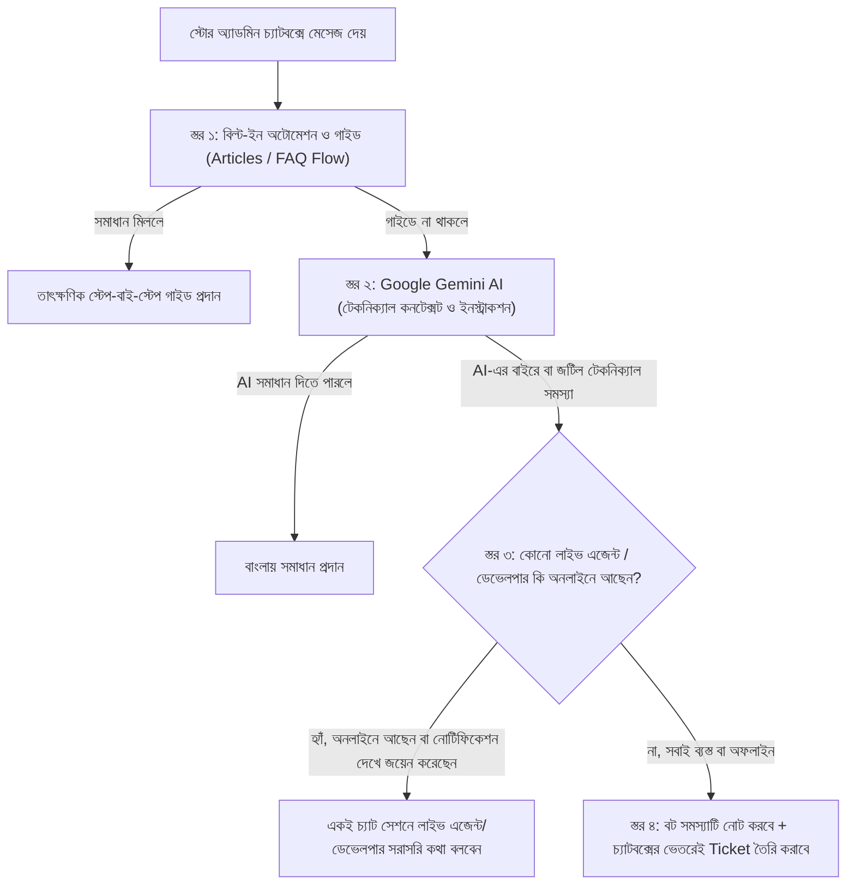

# 💬 প্ল্যান: ইন-হাউস AI + লাইভ এজেন্ট + ইন-বক্স টিকিটিং সাপোর্ট সিস্টেম (Intercom-Style Isolated Tool)

> **স্ট্যাটাস:** 📋 PLANNED (ইমপ্লিমেন্টেশনের জন্য সংরক্ষিত — পর্ব ৬)  
> **বেস সোর্স:** লোকাল `Support Board v3.8.9` (`C:\Users\arraa\Downloads\Live Chat Support\New folder\codecanyon-support-board-chat-and-help-desk-V3.8.9\supportboard 3.8.9\supportboard`) + কাস্টম **Google Gemini AI & Inline Ticket Bridge**  
> **টার্গেট পাথ:** `public/support-desk/` (মূল প্রজেক্ট থেকে ১০০% বিচ্ছিন্ন প্লাগ-অ্যান্ড-প্লে টুল)  
> **কিল-সুইচ (`.env`):** `SUPPORT_DESK_ENABLED=true`

---

## ১. মূল উদ্দেশ্য ও আর্কিটেকচারাল নীতি

1. **মূল প্রজেক্টের কোডে ০% হস্তক্ষেপ (Zero Core Impact):**
   - লারাভেলের কোর `app/`, `routes/`, `database/`, বা `vendor/` ফোল্ডারে কোনো পরিবর্তন করা হবে না।
   - সাপোর্ট সিস্টেমটি একটি স্বতন্ত্র টুল হিসেবে `public/support-desk/` ফোল্ডারে থাকবে।
   - স্টোর অ্যাডমিন প্যানেলের ফুটারে (`resources/views/layouts/app.blade.php`-এর `</body>`-এর আগে) মাত্র ১টি `@if(env('SUPPORT_DESK_ENABLED', false))` ব্লক থাকবে। চাইলে যেকোনো মুহূর্তে `.env` থেকে বন্ধ করা বা পুরো ফোল্ডার সরিয়ে ফেলা যাবে।

2. **কোনো থার্ড-পার্টি নির্ভরতা নেই (No Telegram / External Broker):**
   - সম্পূর্ণ নিজস্ব ইন-হাউস সাপোর্ট পোর্টাল (`/support-desk/admin.php`)।
   - ফোনের ব্রাউজারে **PWA অ্যাপ (`manifest.json`)** হিসেবে ইনস্টলযোগ্য এবং নিজস্ব **Web Push + Sound Notification** যুক্ত।

3. **এমপ্লয়িদের জন্য আলাদা রোল-বেসড অ্যাক্সেস (Super Admin সুরক্ষা):**
   - সাপোর্ট কর্মীদের কখনোই মূল eCommerceGo **Super Admin** প্যানেলের অ্যাক্সেস দেওয়া হবে না।
   - কর্মীরা তাদের নিজস্ব **User ID (Email) ও Password** দিয়ে সরাসরি `/support-desk/admin.php`-এ লগইন করবে।
   - ৩টি রোল থাকবে:
     - **`Agent` (সাপোর্ট কর্মী):** শুধু স্টোর অ্যাডমিনদের চ্যাট ও টিকেটের উত্তর দিতে পারবে।
     - **`Supervisor` (টিম লিড/ম্যানেজার):** চ্যাট তদারকি, গাইড/আর্টিকেল আপডেট ও রিপোর্ট দেখতে পারবে।
     - **`Admin` (মালিক / ডেভেলপার):** পূর্ণ নিয়ন্ত্রণ, এজেন্ট তৈরি এবং সুপার অ্যাডমিন থেকে ১-ক্লিক অ্যাক্সেস।

---

## ২. ডাইনামিক সাপোর্ট ওয়ার্কফ্লো (AI অটোমেশন → লাইভ এজেন্ট → অটো নোট ও টিকিটিং)

এই সিস্টেমে কোনো কঠোর অফিস-টাইম লকআউট থাকবে না—যেকোনো সময় (অফিস টাইমে এমপ্লয়িরা বা অন্য যেকোনো সময় ডেভেলপার/অ্যাডমিন অনলাইনে থাকলে) সরাসরি লাইভ কথা বলতে পারবেন।

### স্তর ১ ও ২: ম্যাক্সিমাম AI ও ইনস্ট্রাকশন অটোমেশন
- `Support Board v3.8.9`-এর `include/functions.php` ও `include/messages.php`-এ থাকা `sb_open_ai_message()` হুকের জন্য আমরা `public/support-desk/apps/dialogflow/functions.php` তৈরি করব।
- সেখানে প্রথমে আমাদের কাস্টম **Store Admin Knowledge Base** (প্রোডাক্ট অ্যাড, অর্ডার ম্যানেজমেন্ট, কুরিয়ার ও ফ্রড শিল্ড, মেটা পিক্সেল CAPI, থিম কাস্টমাইজেশন, ডোমেইন সেটআপ) থেকে উত্তর খুঁজবে।
- প্রয়োজনে আমাদের **ফ্রি Google Gemini API Key** ব্যবহার করে স্টোর অ্যাডমিনকে বাংলায় নির্ভুল গাইড দেবে।

### স্তর ৩: যেকোনো সময় লাইভ এজেন্ট / ডেভেলপার হ্যান্ডঅফ
- সমস্যাটি টেকনিক্যাল হলে বা স্টোর অ্যাডমিন সরাসরি কথা বলতে চাইলে আমাদের সাপোর্ট পোর্টালে (`admin.php`) ও ফোনের PWA অ্যাপে সাথে সাথে নোটিফিকেশন যাবে।
- অফিস আওয়ারে থাকা এমপ্লয়ি হোক বা যেকোনো সময় আপনি/ডেভেলপার হোক—পোর্টালে ঢুকেই সাথে সাথে লাইভ চ্যাটে যুক্ত হতে পারবেন।

### স্তর ৪: এজেন্ট ব্যস্ত/অফলাইন থাকলে অটো-নোট ও ইন-বক্স টিকিটিং (Graceful Fallback)
- যদি সমস্যাটি AI বা অটোমেশনের বাইরে হয় **এবং** সেই মুহূর্তে কোনো লাইভ এজেন্ট অ্যাভেলেবেল না থাকেন (বা নির্দিষ্ট সময়ের মধ্যে কেউ জয়েন না করেন), তবে বট স্বয়ংক্রিয়ভাবে বলবে:
  > *"অনুগ্রহ করে অপেক্ষা করুন, আমি আপনার সমস্যাটি নোট করে রাখছি। এই মুহূর্তে আমাদের সকল সাপোর্ট এজেন্ট ব্যস্ত আছেন। যত দ্রুত সম্ভব আমাদের টিম আপনার সাথে যোগাযোগ করে আপনার সমস্যার সমাধান করবে। এছাড়া ভবিষ্যতের ট্র্যাকিংয়ের জন্য আপনি নিচে একটি সাপোর্ট টিকেট তৈরি করে রাখতে পারেন।"*
- একই সাথে চ্যাটবক্সের ভেতরেই:
  1. কথোপকথনটি স্বয়ংক্রিয়ভাবে **`[Pending Follow-up / Note]`** হিসেবে মার্ক হয়ে অ্যাডমিন পোর্টালে সেভ হবে।
  2. চ্যাটবক্সের ভেতরেই **Inline Ticket Card** ভেসে উঠবে (যেখানে স্টোরের নাম, অ্যাডমিনের নাম ও ইমেইল অটো-ফিল থাকবে; শুধু সমস্যার ক্যাটাগরি/স্ক্রিনশট দিয়ে ১ ক্লিকে **Ticket ID `#TKT-...`** জেনারেট করতে পারবে)।

---

## ৩. Intercom Messenger স্টাইল চ্যাটবক্স UI

স্টোর অ্যাডমিন প্যানেলের ডানপাশের নিচে থাকা চ্যাট উইজেটটি হুবহু **Intercom Messenger**-এর মতো ৩টি ট্যাবে সাজানো থাকবে:

1. **`Home` ট্যাব:**
   - স্টোর অ্যাডমিনের নামসহ স্বাগতম বার্তা (`"Hi [Name] 👋 How can we help?"`)
   - `"Send us a message"` ও `"🚀 শুরু করুন"` কুইক অ্যাকশন বাটন
   - `"Search for help"` (তাৎক্ষণিক গাইড সার্চ বার)
2. **`Messages` ট্যাব:**
   - AI বট + লাইভ এজেন্ট চ্যাট উইন্ডো (`"টিমটিও সাহায্য করতে পারে"`)
   - ফাইল/স্ক্রিনশট অ্যাটাচমেন্ট, ইমোজি, ভয়েস মেসেজ ও কুইক রিপ্লাই বাটন
3. **`Help / Tickets` ট্যাব:**
   - ক্যাটাগরিভিত্তিক স্টোর অ্যাডমিন গাইড (Articles)
   - চ্যাটবক্সের ভেতর থেকেই নতুন **Support Ticket** খোলা এবং পুরনো টিকেটের বর্তমান স্ট্যাটাস (`Open` / `In Progress` / `Resolved`) দেখার সুবিধা

---

## ৪. ইমপ্লিমেন্টেশন ধাপসমূহ (যখন কাজ শুরু করার নির্দেশ দেওয়া হবে)

| ধাপ | কাজ | ফাইল / লোকেশন |
|---|---|---|
| **ধাপ ১** | `Support Board v3.8.9` ফাইলগুলো ক্লিনভাবে `public/support-desk/`-এ স্থাপন ও ডেটাবেস সংযোগ কনফিগার করা | `public/support-desk/config.php` |
| **ধাপ ২** | ফ্রি **Google Gemini API + Store Admin Knowledge Base** ও স্মার্ট ফলব্যাক ব্রিজ তৈরি করা | `public/support-desk/apps/dialogflow/functions.php` |
| **ধাপ ৩** | এজেন্ট ব্যস্ত/অফলাইন থাকলে **Auto Problem Note + Inline Ticket Card** মডিউল যুক্ত করা | `public/support-desk/apps/tickets/functions.php` |
| **ধাপ ৪** | চ্যাট উইজেটে **Intercom 3-Tab (`Home / Messages / Help & Tickets`)** থিম ও বাংলা স্ট্রিং যুক্ত করা | `public/support-desk/css/intercom-skin.css`, `js/intercom-skin.js` |
| **ধাপ ৫** | এমপ্লয়িদের রোল (`Agent`, `Supervisor`, `Admin`) ও মোবাইল **PWA (`manifest.json` + Push Notification)** কনফিগার করা | `public/support-desk/admin.php`, `resources/json/settings.json` |
| **ধাপ ৬** | স্টোর অ্যাডমিন প্যানেলে অটো-লগইন পাসিং ও `.env` কিল-সুইচ (`SUPPORT_DESK_ENABLED`) যুক্ত করা | `resources/views/layouts/app.blade.php` |

